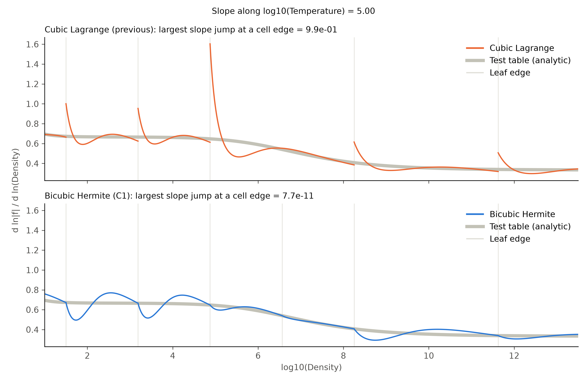
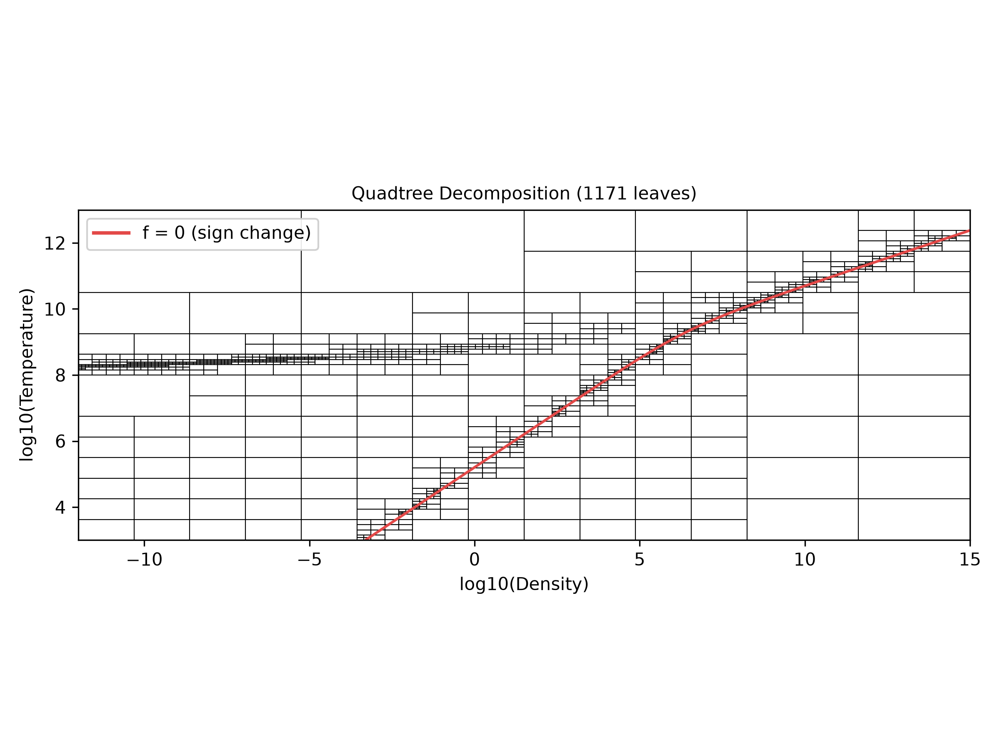
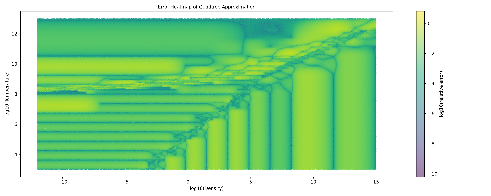
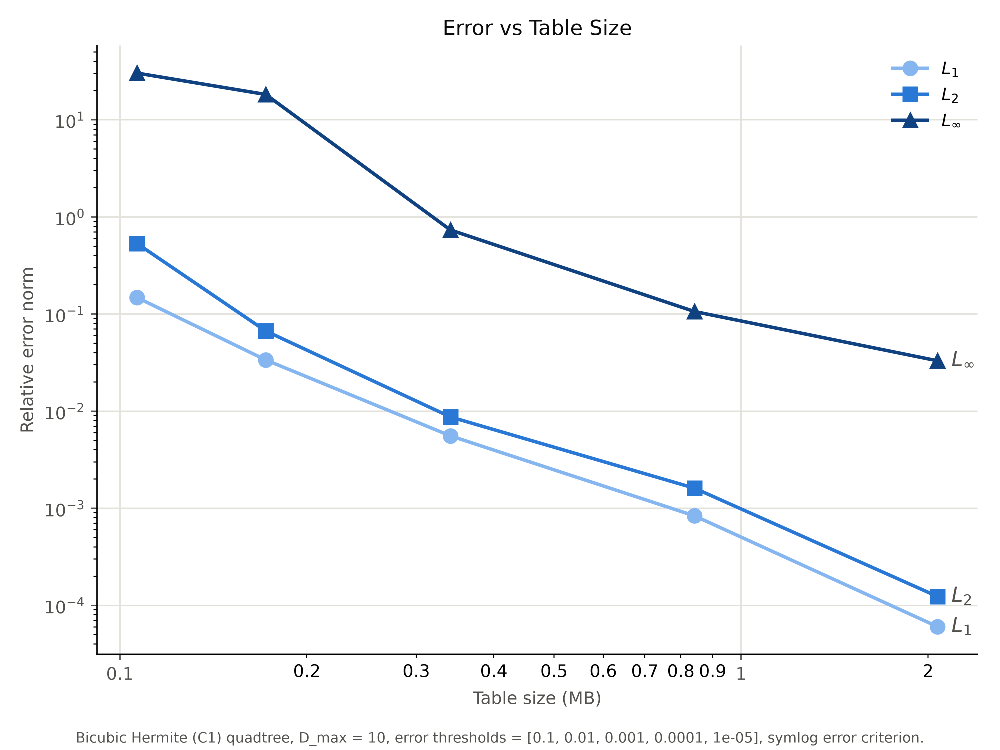

# Report: C1 Bicubic Hermite Quadtree Interpolant

Session dates: 2026-10-11 to 2026-10-12. Branch `hdf5`; all work is uncommitted on top of `ddf1097` ("About to change to cubic interpolant.").

## Summary

The quadtree's per-leaf interpolant was changed from **cubic Lagrange** to a **bicubic Hermite** patch whose value and gradient are continuous (C1) across every cell boundary, including where cell sizes change. Leaves interpolate a log-scaled value, g = symlog(f, 1e21), not raw f. Saved trees now use a **flat-array HDF5 format** that is about 15× smaller.

Headline numbers (depth 8, threshold 0.01, 1e6 test points, relative error |tree − f| / |f|):

| | Leaves | File size | L1 | L2 | Linf |
|---|---|---|---|---|---|
| Cubic Lagrange (starting point) | 1288 | 2.54 MB | 2.62e-2 | 4.87e-2 | 2.33 |
| **Bicubic Hermite, C1, symlog 1e21 (final)** | **1171** | **0.15 MB** | 3.37e-2 | 6.70e-2 | 18.3 |

Measured continuity across all 2673 neighbouring leaf pairs: value and slope mismatches of about 1e-15 (machine precision). Build time for a depth-8 tree is about 2.5 s; the previous builder took hours.

The final Hermite tree is slightly smaller than the Lagrange one (in leaves) and C1, with the same median error. Lagrange still has lower L1/L2 at this setting and a much smaller worst case. The worst case for both comes from cells along the curve where f changes sign (see [Limitations](#limitations-and-open-items)).

---

## 1. Starting point

The original interpolant (`cpp/polyinterp.cpp`, `evaluate_quad_error` in `python/build_quadtree.py`) was a **tensor-product cubic Lagrange polynomial** on a 4×4 stencil per cell:

- Nodes at normalized positions {0, 1/3, 2/3, 1} in each direction.
- The 16 stencil values came from a global `RegularGridInterpolator` (method `"pchip"`) of the training table.
- Each leaf stored the 4×4 stencil values.

Neighbouring cells share the values at their common edge nodes, but nothing ties their derivatives together, so the slope jumps at every cell boundary. The value also jumps where a large cell meets smaller ones.

## 2. Data facts that shaped the design

| Item | Value |
|---|---|
| Training grid | 4321 (log10 den, −12 to 15) × 1601 (log10 T, 3 to 13), spacing 0.00625 (160 points/decade) |
| Test grid | 6480 × 2400, offset half a cell from training (240 points/decade) |
| f range | −4.41e49 to 3.73e20; smallest \|f\| on the grid is 3.7e8 |
| Extra fields in the files | `df_dden`, `df_dtemp`, `d2f_dtemp_dden`, `d2f_dden2`, `d2f_dtemp2` (analytic derivatives) |
| Sign change | f = 0 along one curve, from log den ≈ −3.3 at log T = 3 to log den ≈ 13.9 at log T = 12 |

The sign change matters a lot for symlog interpolation. On either side of the curve, |f| is still around 1e13 one grid point away. So symlog(f) with linthresh = 1 jumps by a median of **26.9** between neighbouring grid points across the curve, against at most 3.6 anywhere else.

## 3. Bicubic Hermite interpolant with C1 continuity

### 3.1 Per-leaf patch

Each leaf stores a 4×4 **Hermite matrix** F: the value and the derivatives g_x, g_y and g_xy at its four corners. Derivatives are taken with respect to the log10 coordinates. The patch is

p(x, y) = Σᵢⱼ F[i, j] · Hx[i](x) · Hy[j](y)

with the cubic Hermite basis `[h00, h01, h·h10, h·h11]` (value at lower bound, value at upper bound, slope at lower bound, slope at upper bound). The evaluation loop has the same shape as the old Lagrange one; only the basis changed.

- C++: `polyinterp.evaluate_hermite(F, x, y, bounds)`. The old `evaluate_polynomial` was removed, so a stale compiled module fails loudly instead of silently returning Lagrange results.
- NumPy twin: `hermite_basis`, `hermite_matrix` and `patch_derivatives` in `build_quadtree.py`, used for vectorized evaluation during the build.

### 3.2 Where corner values and derivatives come from

A single global bicubic interpolating spline (`scipy.interpolate.RectBivariateSpline`, `kx=ky=3`, `s=0`) fitted to the whole table supplies corner values and derivatives. It fits in 0.35 s.

Validation against the table's analytic derivatives (after converting them to log10 coordinates with the chain rule):

| Derivative | Median relative difference | Note |
|---|---|---|
| f_x | 6.1e-12 (max 5.4e-10) | near-exact |
| f_y, f_xy | about 6e-8 | Large *relative* outliers occur only where the derivative is ≈ 0. Against finite differences, the spline and the analytic f_y are equally close (median 1.1e-4 of \|f\|). |

The spline was kept rather than the tabulated derivatives because it works for any table, including ones without derivative fields.

### 3.3 Continuity where cell sizes change (hanging nodes)

Neighbouring leaves share the data at shared corners, which already makes equal-size neighbours C1. Where a large cell L meets smaller cells, the small cells have corners lying *inside* L's edge (hanging nodes). Taking those corners from the spline breaks continuity, because L's patch along that edge is a cubic fixed only by L's own two corners.

The fix (`assign_hermite_coefficients`):

1. Identify corners by exact integer coordinates on the finest (2^max_depth) grid.
2. For every leaf edge, find the corners lying strictly inside it, using sorted per-line vertex lists and bisection.
3. Free corners take spline data. A hanging corner takes **(g, g_x, g_y, g_xy) evaluated from the coarse leaf's patch**.
4. Process leaves coarse to fine. A hanging corner depends only on strictly coarser leaves, so one pass resolves everything, including multi-level jumps.

Why this works: along the shared edge, both the value and the normal derivative of a bicubic patch are cubics in the edge coordinate. Each small cell's edge cubic is fixed by data at its endpoints, and that data now equals the coarse cubic there. A cubic is uniquely determined by value and slope at two points, so the small cell reproduces the coarse edge exactly.

### 3.4 Build algorithm

Refining one leaf can change a neighbour's patch (its hanging-node data changes). The build is therefore iterative (`build_quadtree`):

```
repeat:
    assign Hermite matrices to all leaves (with hanging-node constraints)
    compute every leaf's error on the training points it covers
    split every leaf with error > threshold and depth < max_depth
until nothing is split
```

The threshold is checked against the interpolant that is actually saved. Error evaluation is vectorized: the training data is a regular grid, so each leaf covers a rectangular sub-block found with `searchsorted`, and the patch on that block is one matrix product `Bx @ F @ By.T`. The previous per-point Python loop was replaced.

Error metric (unchanged from the original code): max over the cell of |symlog(approx) − symlog(true)| / |symlog(true)|, with linthresh = 1.

### 3.5 Verification

| Check | Result |
|---|---|
| C++ vs NumPy evaluator, 1000 random patches | agree to 1e-12 relative |
| Exact reproduction of a random bicubic polynomial | max error 8.9e-15 |
| Continuity on the saved/reloaded depth-8 tree: 2673 adjacent pairs, 1245 with a size jump | mismatch f 4.2e-14, f_x 6.4e-16, f_y 1.9e-15 (slopes normalized by \|grad\| + \|f\|/h) |
| Same tree with hanging corners taken from the spline (no constraint) | mismatch f 1.6, f_x 0.24, f_y 0.42 |
| Compiled extension | rebuilt for both interpreters: pixi (CPython 3.14t) and conda `quadtree` (CPython 3.14, used by `quadtree_job.sh`) |

### 3.6 First result: interpolating raw f

Interpolating raw f gave a C1 tree that was **less accurate** than Lagrange: 1894 leaves (vs 1288), L1 7.0e-2, L2 0.109, Linf 18.3. Corner-only Hermite data has a larger error constant than a 4×4 interior stencil (in 1D, about 5× larger: t²(1−t)²/24 vs about 0.0123/24).

## 4. Interpolating in symlog space

### 4.1 linthresh = 1 fails at the sign change

Interpolating g = symlog(f) with the standard linthresh = 1 cut median error by about 4.5×. However, cells straddling the sign-change curve must fit a jump of about 27 in g. The cubic overshoots, and inverse_symlog turns the overshoot into astronomically wrong f (raw Linf of 1e158). Taking the corner derivatives from the raw-f spline via the chain rule was worse: corners near the curve get slopes of about 1/distance, and errors overflowed to inf.

### 4.2 linthresh sweep (depth 8, threshold 0.01)

A larger linthresh makes the transform linear wherever |f| < linthresh, so the interpolant passes smoothly through the sign change.

| linthresh | Leaves | Raw L1 | Raw L2 | Raw Linf |
|---|---|---|---|---|
| 1 | 1582–1717 | ≥ 1e152 | inf | ≥ 1e158 |
| 1e15 | 1216–1258 | ≥ 1e13 | ≥ 1e16 | ≥ 1e19 |
| 1e17 | 1081 | 6.2e12 | 5.9e15 | 5.9e18 |
| 1e18 | 1036 | 4.17e-2 | 0.977 | 583 |
| 1e19 | 1069 | 3.82e-2 | 0.181 | 155 |
| 1e20 | 1117 | 4.10e-2 | 8.51e-2 | 25.1 |
| 3e20 | 1156 | 3.14e-2 | 6.75e-2 | 18.3 |
| **1e21** | **1174** | **3.37e-2** | **6.70e-2** | **18.3** |
| 1e22 | 1258 | 4.15e-2 | 7.74e-2 | 18.3 |
| 1e25 | 1480 | 5.32e-2 | 9.09e-2 | 18.3 |
| 1e60 (≡ raw f) | 1894 | 7.01e-2 | 0.109 | 18.3 |

Ranges for 1 and 1e15 cover the two derivative sources tried (a spline of symlog f, and chain-rule derivatives of the raw-f spline). Rows from 1e17 up use chain-rule derivatives; the final code (spline of symlog f) gives 1171 leaves and the same norms at 1e21. The 1e60 row reproduces the raw-f tree exactly, which confirms the setup.

### 4.3 Depth 10, threshold 1e-3

| linthresh | Leaves | Raw L1 | Raw L2 | Raw Linf |
|---|---|---|---|---|
| 1e20 | 2884 | 6.27e-3 | 9.99e-3 | 1.58 |
| 3e20 | 2737 | 5.99e-3 | 9.10e-3 | 1.09 |
| **1e21** | **2698** | **5.57e-3** | **8.72e-3** | **0.73** |
| 1e60 (≡ raw f) | 4846 | 6.97e-3 | 9.69e-3 | 1.35 |

The 1e21 row is the final code. The other rows used chain-rule derivatives, which at 1e21 give L1 5.58e-3, L2 8.75e-3, Linf 0.96.

### 4.4 Final choice

- **`value_linthresh = 1e21`**, a config parameter at the top of `build_quadtree.py`. It is just above the largest positive f (3.7e20), so the transform is linear through the sign change and across the positive region, and logarithmic in the large negative (high-density) region.
- Corner data comes from a spline fitted directly to symlog(f, 1e21). At this linthresh it gives the same trees as the chain-rule variant (1171 vs 1174 leaves, same errors) and is simpler.
- `value_linthresh` is stored in each tree file, and `QuadTreeNode.evaluate` returns inverse_symlog(patch, value_linthresh), so callers still get f.
- C1 in g implies C1 in f, because inverse_symlog is continuously differentiable.

## 5. Error results (final interpolant)

Measured on the 1e6 random test points that `calc_error.py` samples (seed 1). "Symlog" is the training metric.

### Depth 8, threshold 0.01

| | Lagrange (old) | Hermite, raw f | **Hermite, symlog 1e21** |
|---|---|---|---|
| Leaves | 1288 | 1894 | **1171** |
| Raw L1 / L2 / Linf | 2.62e-2 / 4.87e-2 / 2.33 | 7.01e-2 / 0.109 / 18.3 | 3.37e-2 / 6.70e-2 / 18.3 |
| Raw median / 99th percentile | 1.24e-2* / 0.218* | 3.08e-2 / 0.277 | 9.90e-3 / 0.238 |
| Symlog median / 99.9th percentile / max | 2.46e-4* / 6.19e-3* / 0.111* | 6.38e-4 / 9.10e-3 / 2.12 | 2.47e-4 / 9.10e-3 / 2.12 |
| Leaves at max depth above threshold | (not recorded) | 29 | 36 |

\*Lagrange percentiles come from a separate 300k-point sample.

### Depth 10, all thresholds (`figs/ErrorVsSize-10-hermite.png`)

| Threshold | Leaves | File size | L1 | L2 | Linf | Leaves at max depth above threshold |
|---|---|---|---|---|---|---|
| 0.1 | 793 | 0.11 MB | 1.48e-1 | 5.33e-1 | 30.3 | 8 |
| 0.01 | 1327 | 0.17 MB | 3.37e-2 | 6.69e-2 | 18.3 | 10 |
| 0.001 | 2698 | 0.34 MB | 5.57e-3 | 8.72e-3 | 0.734 | 32 |
| 1e-4 | 6760 | 0.84 MB | 8.36e-4 | 1.61e-3 | 0.106 | 99 |
| 1e-5 | 16735 | 2.07 MB | 6.03e-5 | 1.23e-4 | 3.30e-2 | 593 |

Build times run from 2.5 s (depth 8) to 11 s (depth 10, 1e-5). Sizes are in the new flat format and in MiB, as `calc_error.py` reports them.

## 6. Visualizations

All are in `figs/` with a `_poster` variant (large fonts) beside each. Colours follow a validated palette: Hermite blue `#2a78d6`, Lagrange orange `#eb6834` (CVD ΔE 24.7, passes all checks), and an ordered blue ramp for L1/L2/Linf.

### Slope continuity: `slope_slice-8-0.01-hermite.png`

d ln|f| / d ln ρ along log T = 5.00 for each tree, against the test table's analytic derivative, with leaf edges marked. The Lagrange slope jumps by up to **0.99** at cell edges. The Hermite slope is continuous (7.7e-11 is finite-difference noise). Its curvature is not continuous, so corners are visible at edges, and it wiggles inside some cells by up to about ±0.15.



### Decomposition: `quadtree_decomp-8-0.01-hermite.png`

The 1171 leaf cells with the f = 0 curve overlaid. Refinement follows the sign-change curve, plus a separate band at log T ≈ 8.2–8.8 at low density.



### Error heatmap: `error_heatmap-8-0.01-hermite.png`

Your existing heatmap style (viridis), kept for side-by-side comparison with the earlier Lagrange figures. Error is lowest along cell edges and highest in the middle of large cells.



### Error vs table size: `ErrorVsSize-10-hermite.png`



## 7. File format

### 7.1 Problem

The previous format stored one HDF5 group per node, with attributes for bounds, `is_leaf` and split point, plus a `coefficients` dataset per leaf. Measured on saved trees, **93% of every file was HDF5 per-object overhead**, about 1.4 kB per node:

| Tree | Nodes (leaves) | Actual data | File |
|---|---|---|---|
| depth 8, 0.01 | 1561 (1171) | 180 kB | 2.42 MB (decimal) |
| depth 10, 1e-5 | 22313 (16735) | 2.57 MB | 34.5 MB (decimal) |

### 7.2 New format (`quadtree_v3`)

| Item | Content |
|---|---|
| `is_leaf` dataset | uint8, one per node in preorder, children in SW, SE, NW, NE order |
| `coefficients` dataset | n_leaves × 4 × 4 float64 Hermite matrices, same preorder |
| Attributes | `format`, `interpolant`, `coord_space`, `value_linthresh`, root `bounds` (float64) |

Every internal node has exactly four children, so the preorder leaf flags fully define the tree. Bounds and split points are not stored; on load they are recomputed from the root bounds by the same `_subdivide` function the build uses.

Round-trip check: all 1561 nodes come back with identical bounds, split points and coefficients, and 20,000 evaluations match bit for bit.

| Tree | Nested format | Flat format |
|---|---|---|
| depth 8, 0.01 | 2420 kB | 160 kB |
| depth 10, 1e-5 | 34501 kB | 2173 kB |

`load_quadtree` rejects anything that isn't `quadtree_v3` with Hermite coefficients, so old Lagrange and nested-Hermite files fail with a "Rebuild the tree" message instead of being misread.

## 8. Code changes by file

| File | Changes |
|---|---|
| `cpp/polyinterp.cpp` | Lagrange basis replaced by the cubic Hermite basis; function renamed `evaluate_hermite`. Compiled `.so` files (and `cpp/build/`) rebuilt for CPython 3.14 and 3.14t. |
| `python/build_quadtree.py` | Config `value_linthresh = 1e21`; constants `FORMAT`, `INTERPOLANT`, `CORNERS`, `QUADRANTS`. NumPy Hermite helpers (`hermite_basis`, `hermite_matrix`, `patch_derivatives`). `QuadTreeNode` carries `value_linthresh` and returns inverse_symlog of the patch. Hanging-node resolution (`Leaf`, `_corner_keys`, `assign_hermite_coefficients`). Vectorized `leaf_error`. `_subdivide` / `_split` / `preorder`. Iterative `build_quadtree(x_coords, y_coords, table_values, error_threshold, max_depth, value_linthresh)` (new signature). Flat `save_quadtree` / `load_quadtree`. Output name `quadtree-{depth}-{thresh}-{res}-hermite.h5`. |
| `python/plotting.py` | Palette constants; `load_log_table`; `plot_decomp` with optional f = 0 overlay and leaf count in the title; `get_leaf_cells` reads the flat format (and still the older ones); new `tree_log_slope_on_row` / `plot_slope_slice` (reads Hermite flat files and nested Lagrange files); output filenames end in `-hermite`; `__main__` produces the Hermite figure set. |
| `python/calc_error.py` | `plot_error_norms(…, output, caption)` restyled (ordered blue ramp, direct labels, plain MB ticks, writes to `figs/`); `__main__` runs over the depth-10 Hermite tables. |
| `README.md` | Workflow, parameters (`value_linthresh`), output format, and the Interpolators section (value space, hanging nodes, rebuilding the extension). |
| `python/common.py`, `python/driver.py` | Unchanged. |

### Files produced

- `tables/quadtree-8-0.01-4321-hermite.h5`, `tables/quadtree-10-{0.1,0.01,0.001,0.0001,1e-05}-4321-hermite.h5` (flat format)
- `figs/slope_slice-8-0.01-hermite[_poster].png`, `figs/quadtree_decomp-8-0.01-hermite[_poster].png`, `figs/error_heatmap-8-0.01-hermite[_poster].png`, `figs/ErrorVsSize-10-hermite.png`
- `figs/heatmap.png` was redrawn by `plotting.py` (same data heatmap).

The existing Lagrange tables and figures were not overwritten.

## 9. How to reproduce

```bash
cd cpp && python setup.py build_ext --inplace
```

```bash
python -m python.build_quadtree
```

```bash
python -m python.calc_error
```

```bash
python -m python.plotting
```

Run these from the repository root (except the extension build), in either the pixi or the conda `quadtree` environment. `build_quadtree` uses `max_depth`, `error_threshold` and `value_linthresh` from the top of the file.

## 10. Limitations and open items

- **The worst-case error sits on the sign-change curve.** Cells straddling f = 0 at max depth dominate Linf (36 such leaves at depth 8 / 0.01, 593 at depth 10 / 1e-5). Relative error is poorly conditioned near f = 0 for any interpolant. At depth 8 / 0.01, Lagrange's worst case is lower (Linf 2.3 vs 18.3).
- **`value_linthresh = 1e21` is tuned to this table** (just above its largest positive f). Another table, such as the Cloudy emission table, needs it re-checked. Values ≲ 1e17 blow up here.
- **Hermite slopes wiggle inside cells.** The slope is continuous but can deviate from the truth mid-cell by about ±0.15 in d ln|f|/d ln ρ, since corner-only data constrains the interior less than an interior stencil does.
- **No Lagrange comparison at depth 10.** Most existing Lagrange tables, including all depth-10 ones except 1e-4, use an older flat format with different value transforms. A comparison would need them rebuilt with the old code.
- **Old size plots aren't comparable.** File sizes in earlier figures, including `ErrorVsSize-10-symlog-error.png`, were inflated about 15× by per-node HDF5 overhead.
- **Old tables no longer load.** Lagrange tables and the nested-format Hermite tables are rejected by `load_quadtree`.
- **`python/driver.py` was already broken before this session.** It imports `calculate_norms_for_quadtree` and `test_func`, which don't exist, and calls an older `build_quadtree` signature.
- **Possible further size reduction:** store corner data per vertex instead of per leaf (neighbours currently duplicate shared corners), roughly 2–3× smaller.
- **Nothing is committed.**
